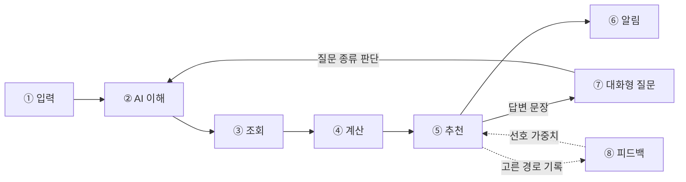

# (가칭) 이동 보조 서비스

> 일정과 할 일을 말로 적어 두면, 언제 준비하고 출발할지 알려 주고, 이동 중 남는 시간에 어떤 할 일을 끼워 넣을 수 있는지 판단해 주며, 이동 중 궁금한 걸 물으면 내 상황에 맞춰 답해 주는 이동 보조 서비스

2026 인공지능학과 대학 연합 해커톤 · 팀 Sync-ro

- 배포 주소: (https://kyuiryo2-max.github.io/hackerton_21/)
- 시연 영상: (녹화 후 추가)

## 서비스 흐름



| 단계 | 하는 일 | 담당 | 우선순위 |
| --- | --- | --- | --- |
| ① 입력 | 목적지, 도착 희망 시각, 준비 시간, 할 일(자연어) + 중요도, 현재 위치(앱 사용 중에만) | 코드 | Must |
| ② AI 이해 | 할 일 → 장소 종류, 질문 → 질문 종류(8종) + 필요한 값 (JSON) | AI | Must |
| ③ 조회 | 좌표 변환, 주변 장소, 도보 경로, 버스·지하철 도착 정보 | 코드 | Must |
| ④ 계산 | 경로별 총 시간(경유 포함/미포함), 경유지 최대 체류 시간, 출발·준비 시각, 시간 부족 시 경유 제외 | 코드 | Must |
| ⑤ 추천 | 경로 2~3개 순위(코드) + 계산 결과를 한두 문장으로 설명(AI) | 코드 + AI | Must |
| ⑥ 알림 | 앱 화면이 열려 있을 때 준비·출발·돌아올 시각 안내 | 코드 | Should |
| ⑦ 대화형 질문 | 질문을 ②에서 판단 → ③④ 다시 계산 → ⑤에서 답변. 이동 중 "들렀다 가도 돼?"는 중요도 높은 할 일로 등록 | AI + 코드 | Must |
| ⑧ 피드백 | 사용자가 고른 경로를 기록하고 선호 가중치에 반영 | 코드 | 기록 Must, 반영은 시간 남으면 |

**AI가 맡는 곳은 ②의 판단과 ⑤의 문장뿐이다.** 시간과 거리 숫자는 전부 코드가 계산하고, AI 답변 속 숫자가 계산값과 다르면 정해진 문장으로 바꾼다.

**시연 모드**: 현재 시각, 위치, 버스 도착 정보를 고정값으로 써서 항상 같은 시나리오가 재현되게 한다. 서버가 켜질 때 시연용 데이터(`user_id = demo`)를 자동으로 넣는다.

### 질문 종류 (⑦)

이름과 JSON 형식의 기준은 [`docs/design/json-format.md`](docs/design/json-format.md). 바꾸면 그 문서, `server/app/prompts/`, `ai/testcases/questions.csv`를 같이 고친다.

| 종류 | 예시 |
| --- | --- |
| `stopover_check` 들르기 | "편의점 들렀다 가도 돼?", "아 우유 사야 돼" |
| `running_late` 늦어짐 | "10분 늦을 것 같아" |
| `next_vehicle` 다음 교통편 | "다음 버스 언제야?" |
| `time_left` 남은 시간 | "몇 분까지 나가면 돼?" |
| `change_todo` 할 일 변경 | "약은 안 사도 돼" |
| `place_info` 장소 정보 | "근처 약국 어디야?" |
| `change_route` 경로 변경 | "환승 적은 걸로" |
| `unsupported` 범위 밖 | "점심 뭐 먹지?" |

## 개발 환경

| 구분 | 버전 |
| --- | --- |
| Flutter | 3.35.7 (웹 빌드 기준) |
| Python | 3.12.16 |
| FastAPI | 0.118.3 |
| 패키지 관리 | uv (uv.lock으로 버전 고정) |
| DB | SQLite |
| LLM | OpenRouter (OpenAI 호환 SDK) |
| 배포 | (결정 후 추가) |

## 외부 API 호출 한도

| API | 무료 한도 | 비고 |
| --- | --- | --- |
| 카카오 대중교통 경로 | 하루 1,000건 | 초과 시 건당 10원. 계정에서 카카오맵을 처음 켠 앱만 무료 |
| 카카오 도보 경로 | 하루 1,000건 | 위와 같음 |
| 카카오 장소 검색, 주소 변환 | 하루 100,000건 | 위와 같음 |
| 서울시 버스 API | 개발계정 하루 1,000건 | 활용사례 등록 시 증가 가능 |
| TAGO | 개발계정 10,000건 (포털 표기) | 서울 없음. "가용한 세션 없음" 혼잡 오류 1회 경험 |
| 서울 실시간 지하철 | 확인 필요 | 역명은 `안암(고대병원앞)`처럼 입력 |

카카오 테스트앱은 더 적은 쿼터가 적용된다. 같은 구간의 경로·도보 결과는 서버 메모리에 저장해 다시 쓴다.

## 폴더 구조

```
.env.example            키 이름만, 값 없이 (복사해서 루트에 .env)
.python-version         3.12.16

app/
  README.md             앱 실행 방법
  Sync_ro_app/          Flutter 프로젝트 (web · android · ios)
    lib/                화면 코드
    web/                웹 빌드 설정
    pubspec.yaml / pubspec.lock

server/                 FastAPI 서버
  app/
    main.py             서버 진입점, /health
    config.py           루트 .env 읽기
    routers/            API 주소
    services/
      timecalc.py       출발·준비 시각, 최대로 쓸 수 있는 시간 (외부 호출 없는 계산)
      llm.py            OpenRouter 호출, 장소 목록 검사, 답변 숫자 대조
      kakao.py          주소, 장소, 대중교통·도보 경로 (같은 구간은 메모리에 잠시 저장)
    prompts/v1/         프롬프트 버전 (v1, v2 …)
    db/database.py      SQLite 테이블, 시연용 데이터 자동 입력
  tests/                계산·검사 테스트 (LLM 호출 없음, CI에서 실행)
  pyproject.toml / uv.lock

ai/
  pipeline.py           확정 규격 AI 파이프라인 (스키마 검증, 시간/경로 계산 엔진)
  test_runner.py        40개 테스트 케이스 종합 로컬 검증 러너
  testcases/            테스트 문장 + 기대 결과 CSV (질문 25 + 할 일 15)
  eval/run.py           키워드 규칙 vs AI 정답률 비교
  results/              프롬프트 버전별 결과표 (v1 → v2 전후 비교)
  README.md             AI 모듈 상세 규격 및 40개 테스트 실행 결과 리포트

data/
  demo/place_types.csv  장소 종류 목록 (AI가 고를 수 있는 값)
  samples/              외부 API 실제 응답 샘플 JSON (키·개인정보 제거)

docs/
  design/json-format.md AI 출력 JSON 형식, 질문 종류 ← 서버·AI·앱 공통 약속
  research/             설문 요약, 인터뷰 메모 (개인정보 X)
  reports/              중간·최종 보고서
  presentation/         포스터, 발표 자료, 시연 대본

scripts/
  tasks.csv             작업 표 (62개)
  create_issues.py      작업 표 → GitHub 라벨·마일스톤·이슈
.github/workflows/      CI (server/tests 실행)
```

서버는 `data/demo/`와 루트 `.env`를 읽으므로, 배포할 때 저장소 전체를 받고 `server/`에서 실행되도록 설정한다.

## 실행 방법

### 서버

```bash
uv self update                 # 예전 uv는 3.12.16을 못 받아요. 먼저 최신으로
uv python install 3.12.16
cp .env.example .env           # 저장소 루트에서. 키 값 채우기
cd server
uv sync
uv run uvicorn app.main:app --reload
# http://127.0.0.1:8000/health
# http://127.0.0.1:8000/docs   (API 직접 호출해 보기)
```

테스트:

```bash
cd server
uv run pytest
```

AI 정답률 평가 (LLM 호출, 로컬에서만):

```bash
cd server
uv run python ../ai/eval/run.py --prompt v1
`

AI 파이프라인 종합 로컬 검증 (40개 테스트 케이스 100% 통과):

`ash
# 40개 전체 테스트 케이스 종합 검증 (Questions 25개 + Tasks 15개 100% 통과)
python ai/test_runner.py

# 확정 규격 5종 시나리오 데모 실행
python ai/pipeline.py --demo
```

### 앱 (Flutter 웹)

```bash
flutter --version              # 3.35.7 확인
cd app/Sync_ro_app
flutter pub get
flutter run -d chrome --dart-define=API_BASE_URL=http://127.0.0.1:8000
```

배포 후에는 서버의 CORS 허용 목록(`server/app/main.py`, 지금은 전체 허용)을 앱 주소로 좁힌다.

### 이슈 만들기 (처음 한 번)

```bash
gh auth login
python scripts/create_issues.py --dry-run   # 미리 보기
python scripts/create_issues.py
```

## 협업 규칙

- main에 직접 push 금지. 기능 하나당 브랜치 하나 → PR → 팀원 1명 확인 후 머지
- 브랜치 이름: `feat/<이슈번호>-<짧은설명>` (예: `feat/29-max-stay-time`), 문서는 `docs/<번호>-...`
- PR 본문에 `Closes #이슈번호`를 쓰면 머지할 때 이슈가 자동으로 닫힌다
- API 키는 루트 `.env`에만. 코드·카톡·노션에 붙여 넣지 않기. 배포 서버 키는 GitHub/배포 서비스의 Secrets에
- 앱(Flutter) 코드에는 어떤 키도 넣지 않는다. 웹 빌드는 누구나 열어 볼 수 있다
- 설문 원본(이름·연락처)은 올리지 않고 요약본만 `docs/research/`에
- 매일 밤 10시: 단톡에 "오늘 끝낸 이슈 번호 / 막힌 것" 한 줄 공유. 30분 넘게 막히면 바로 공유
- 11/13부터 새 기능 금지, 버그 수정과 다듬기만

## 일정

| 마일스톤 | 날짜 |
| --- | --- |
| M1 중간 보고 | 11/8 (일) 23:59 |
| 온라인 멘토링 | 11/10 (화) ~ 11/12 (목) |
| M2 기능 완성 | 11/12 (목) |
| 기능 동결 · 사용성 테스트 | 11/13 (금) |
| M3 최종 제출 (포스터, 배포 링크, 시연 영상, 보고서) | 11/16 (월) |
| 결선 발표 팀 공개 | 11/20 (금) |
| M4 본행사 | 11/21 (토) |
