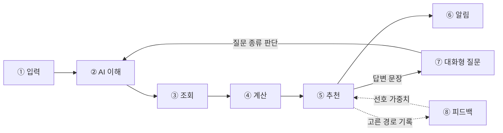

# (가칭) 이동 보조 서비스

> 일정과 할 일을 말로 적어 두면, 언제 준비하고 출발할지 알려 주고, 이동 중 남는 시간에 어떤 할 일을 끼워 넣을 수 있는지 판단해 주며, 이동 중 궁금한 걸 물으면 내 상황에 맞춰 답해 주는 이동 보조 서비스

2026 인공지능학과 대학 연합 해커톤 · 팀 Sync-ro

- 배포 주소: (배포 후 추가)
- 시연 영상: (녹화 후 추가)

## 서비스 흐름



| 단계 | 하는 일 | 담당 | 우선순위 |
| --- | --- | --- | --- |
| ① 입력 | 목적지, 도착 희망 시각, 준비 시간, 할 일(자연어) + 중요도, 현재 위치(앱 사용 중에만) | 코드 | Must |
| ② AI 이해 | 할 일 → 장소 종류, 질문 → 질문 종류(8종) + 필요한 값 (JSON) | AI | Must |
| ③ 조회 | 좌표 변환, 주변 장소, 도보 경로, 버스·지하철 도착 정보 | 코드 | Must |
| ④ 계산 | 경로별 총 시간(경유 포함/미포함), 경유지 최대 체류 시간, 출발·준비 시각, 시간 부족 시 경유 제외 | 코드 | Must |
| ⑤ 추천 | 경로 2~3개 순위(코드) + 계산 결과를 한두 문장으로 설명(AI) | 코드 + AI | Must |
| ⑥ 알림 | 앱 화면이 열려 있을 때 준비·출발·돌아올 시각 안내 | 코드 | Should |
| ⑦ 대화형 질문 | 질문을 ②에서 판단 → ③④ 다시 계산 → ⑤에서 답변. 이동 중 "들렀다 가도 돼?"는 중요도 높은 할 일로 등록 | AI + 코드 | Must |
| ⑧ 피드백 | 사용자가 고른 경로를 기록하고 선호 가중치에 반영 | 코드 | 기록 Must, 반영은 시간 남으면 |

**AI가 맡는 곳은 ②의 판단과 ⑤의 문장뿐이다.** 시간과 거리 숫자는 전부 코드가 계산하고, AI 답변 속 숫자가 계산값과 다르면 정해진 문장으로 바꾼다.

**시연 모드**: 요청에 `demo=true`를 주면 현재 시각, 위치, 버스 도착 정보를 고정값으로 써서 항상 같은 시나리오가 재현된다.

### 질문 종류 (⑦)

| 종류 | 예시 |
| --- | --- |
| add_stop 경유 추가 | "편의점 들러도 돼?", "아 우유 사야 돼" |
| delay 지연 | "10분 늦을 것 같아" |
| next_transit 다음 교통편 | "다음 버스 언제야?" |
| time_left 남은 시간 | "몇 분까지 나가면 돼?" |
| change_task 할 일 변경 | "약은 안 사도 돼" |
| place_info 장소 정보 | "근처 약국 어디야?" |
| change_route 경로 변경 | "환승 적은 걸로" |
| out_of_scope 범위 밖 | "점심 뭐 먹지?" |

## 개발 환경

| 구분 | 버전 |
| --- | --- |
| Flutter | 3.35.7 (웹 빌드 기준) |
| Python | 3.12.16 |
| FastAPI | 0.118.3 |
| 패키지 관리 | uv (uv.lock으로 버전 고정) |
| DB | SQLite |
| LLM | OpenRouter (OpenAI 호환 SDK) |
| 배포 | (결정 후 추가) |

## 폴더 구조

```
app/                    Flutter 웹 앱
  lib/
    screens/            입력 · 할 일 확인 · 추천 결과 · 이동 중
    services/           서버 API 호출
    models/             API 요청·응답 모델
  assets/mock/          서버 완성 전 화면 개발용 가짜 응답 JSON

server/                 FastAPI 서버 (이 폴더 단위로 배포)
  app/
    main.py
    config.py           .env 읽기
    routers/            /api/plan, /api/ask, /api/tasks/parse, /api/arrivals, /api/choice
    schemas/            요청·응답 형식 (Pydantic) ← 프론트와의 약속 기준
    services/
      transit.py        버스·지하철 도착, 경로 (외부 API)
      places.py         좌표 변환, 주변 장소 검색
      planner.py        총 시간 · 최대 체류 시간 · 출발 시각 계산 (외부 호출 없는 함수)
      llm.py            OpenRouter 호출, JSON 파싱, 답변 숫자 대조
    prompts/            프롬프트 버전 (v1, v2 …)
    demo/               시연 모드 고정 데이터, 장소 종류 표
    db/                 SQLite 연결, 테이블
  tests/
    unit/               계산·파싱 테스트 (LLM 호출 없음, CI에서 실행)
  pyproject.toml
  uv.lock
  .env.example          키 이름만, 값 없이

ai/
  testcases/            테스트 문장 + 기대 동작 CSV
  eval/                 키워드 규칙 vs AI 정답률 비교 스크립트
  results/              프롬프트 버전별 결과표 (v1 → v2 전후 비교)

data/
  samples/              외부 API 실제 응답 샘플 JSON (키·개인정보 제거)

docs/
  research/             설문 요약, 인터뷰 메모 (개인정보 X)
  design/               화면 스케치, api.md (요청·응답 예시)
  reports/              중간·최종 보고서
  presentation/         포스터, 발표 자료, 시연 대본

scripts/                GitHub 이슈 생성 스크립트 등
.github/workflows/      CI (server/tests/unit 실행)
```

## 실행 방법

### 서버

```bash
uv self update                 # 예전 uv는 3.12.16을 못 받아요. 먼저 최신으로
uv python install 3.12.16
cd server
cp .env.example .env           # 키 값 채우기
uv sync
uv run uvicorn app.main:app --reload
# http://127.0.0.1:8000/health
```

테스트:

```bash
cd server
uv run pytest tests/unit
```

AI 정답률 평가 (LLM 호출, 로컬에서만):

```bash
cd server
uv run python ../ai/eval/run.py --prompt v1
```

### 앱 (Flutter 웹)

```bash
flutter --version              # 3.35.7 확인
cd app
flutter pub get
flutter run -d chrome --dart-define=API_BASE=http://127.0.0.1:8000
```

앱과 서버 주소가 다르므로 서버의 CORS 허용 목록에 앱 주소를 넣어야 한다.

## 협업 규칙

- main에 직접 push 금지. 기능 하나당 브랜치 하나 → PR → 팀원 1명 확인 후 머지
- 브랜치 이름: `feat/<이슈번호>-<짧은설명>` (예: `feat/29-max-stay-time`), 문서는 `docs/<번호>-...`
- PR 본문에 `Closes #이슈번호`를 쓰면 머지할 때 이슈가 자동으로 닫힌다
- API 키는 `server/.env`에만. 코드·카톡·노션에 붙여 넣지 않기. 배포 서버 키는 GitHub/배포 서비스의 Secrets에
- 앱(Flutter) 코드에는 어떤 키도 넣지 않는다. 웹 빌드는 누구나 열어 볼 수 있다
- 설문 원본(이름·연락처)은 올리지 않고 요약본만 `docs/research/`에
- 매일 밤 10시: 단톡에 "오늘 끝낸 이슈 번호 / 막힌 것" 한 줄 공유. 30분 넘게 막히면 바로 공유
- 11/13부터 새 기능 금지, 버그 수정과 다듬기만

## 일정

| 마일스톤 | 날짜 |
| --- | --- |
| M1 중간 보고 | 11/8 (일) 23:59 |
| 온라인 멘토링 | 11/10 (화) ~ 11/12 (목) |
| M2 기능 완성 | 11/12 (목) |
| 기능 동결 · 사용성 테스트 | 11/13 (금) |
| M3 최종 제출 (포스터, 배포 링크, 시연 영상, 보고서) | 11/16 (월) |
| 결선 발표 팀 공개 | 11/20 (금) |
| M4 본행사 | 11/21 (토) |
